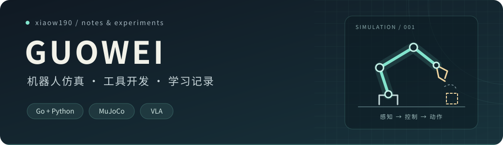

  

你好，我是 **Guowei**，也可以叫我 **xiaow190**。

这里放一些 Go 后端和 Python 小工具，也记录最近在做的机器人仿真与 VLA 实验。喜欢把东西跑起来，再弄明白它为什么能工作。

### 最近在做

- **机器人仿真**：用 MuJoCo 运行模型，尝试在浏览器里查看和控制仿真。
- **果蝇运动控制**：复现 [FlyControl](https://github.com/THU-NeuroML/FlyControl)，学习步态、感觉反馈和连接组控制。
- **VLA 实验**：学习把模型推理服务接入仿真，检查动作输出和执行结果。

### 代码入口

| 项目 | 内容 | 技术 |
| :--- | :--- | :--- |
| [blog_service](https://github.com/xiaow190/blog_service) | 基于 Gin 的博客后端 | Go · Gin |
| [go-programming-tour-book](https://github.com/xiaow190/go-programming-tour-book) | Go 工具集与练习 | Go |
| [PieMenu](https://github.com/xiaow190/PieMenu) | 环形菜单控件与云台按钮 | Python · PyQt5 |

### 开源学习

下面是我 Fork 的项目，链接指向自己的副本，原项目一并标在后面。

- [RoboOS](https://github.com/xiaow190/RoboOS) — 机器人操作系统与多机器人协作，来自 [FlagOpen/RoboOS](https://github.com/FlagOpen/RoboOS)。
- [FlagEvalMM](https://github.com/xiaow190/FlagEvalMM) — 多模态模型评测框架，来自 [flageval-baai/FlagEvalMM](https://github.com/flageval-baai/FlagEvalMM)。
- [FlagScale](https://github.com/xiaow190/FlagScale) — 大模型工具链，来自 [flagos-ai/FlagScale](https://github.com/flagos-ai/FlagScale)。

---

  Go / Python · MuJoCo / VLA · 边做边学，记录过程

